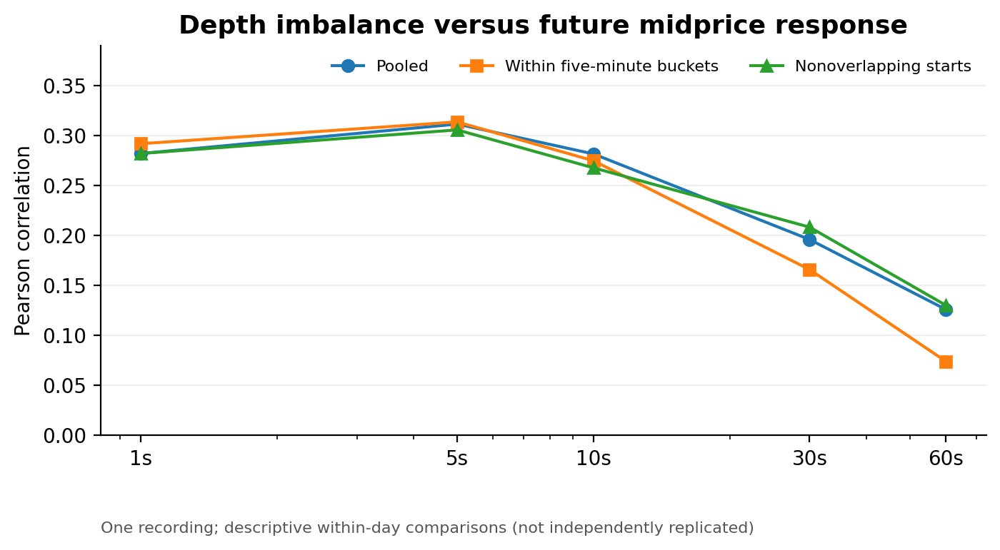
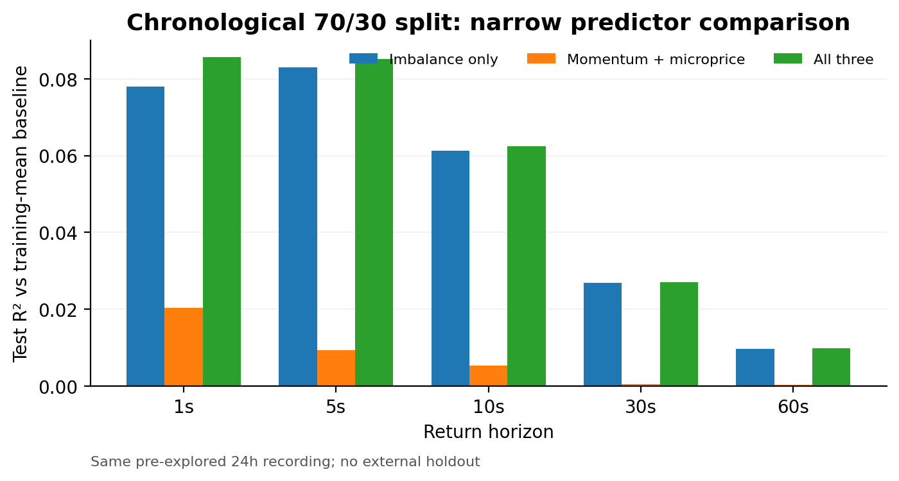
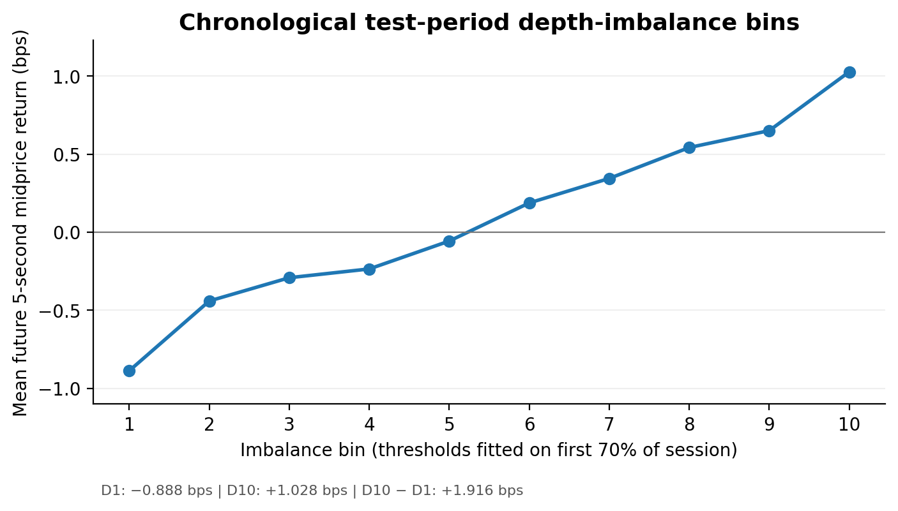

# Displayed Order-Book Imbalance and Short-Horizon Midprice Response in Kraken BTC/USD

**Jude Kriel Ramcharitar — Sole Creator and Author**  
Independent quantitative research | 4 November 2026

*Research working paper — exploratory; not peer reviewed or independently replicated.*

## Abstract

This study examines whether contemporaneous displayed limit-order-book depth imbalance is associated with subsequent Bitcoin/U.S. dollar midprice movements over one to sixty seconds on Kraken. The dataset comprises one nearly 24-hour Level 2 WebSocket recording on 3–4 November 2026, with **12,973,391** recorded book-update messages across **33** separately initialized segments and **86,057** one-second order-book observations. The collection was interrupted by seven reconnect events; their partial files were recovered, and a previous validation run reported exchange CRC32 checks on all segments. A single **1.640-second** local receive-clock reversal was isolated and guarded against in return matching. During this one-day sample, ten-level depth imbalance was positively correlated with five-second forward midprice return (**r = +0.3113** pooled), and a within-five-minute correlation of **+0.3136** persisted under retrospective demeaning. A chronological 70/30 imbalance-only model obtained a five-second test **R² = +0.0829** against a constant training-mean baseline; a three-feature model achieved **+0.0851** compared with **+0.0093** for momentum plus microprice alone. Train-calibrated imbalance bins in the later test interval showed a **+1.9160 basis-point** top-minus-bottom difference in mean five-second future midprice return. These findings are **within-day exploratory associations**, subject to horizon selection, serial dependence, venue specificity, and development-set reuse. They identify neither causal market impact nor executable trading profitability.

**Keywords:** Bitcoin; limit-order book; displayed liquidity; depth imbalance; market microstructure; short-horizon forecasting; exploratory time-series analysis

## 1. Research question and scope

The research question is whether the imbalance of *displayed resting quantities* on the bid and ask sides predicts subsequent midprice changes relative to simple within-day baselines. A separate descriptive component examines bid-ask spreads, visible depth, and the hypothetical cost of walking the currently displayed book.

This distinction matters. Cont, Kukanov and Stoikov (2014) study **order-flow imbalance**, an event-based net supply/demand measure. The predictor here is instead a **stock-of-depth imbalance** from the top ten displayed price levels; the two are not interchangeable. The dataset is a Level 2 *aggregated price-level feed*, not order-level data or a synchronized record of executions, cancellations, and parent orders. Consequently, the research does not identify a causal market-impact response.

## 2. Data provenance, recording integrity, and eligibility

**Venue and feed.** Kraken spot BTC/USD, WebSocket v2 `book` channel, depth 100, via `wss://ws.kraken.com/v2`. Kraken describes this channel as aggregated quantities at price levels, with CRC32 checksums of the top ten bid and ask levels (Kraken API Center, 2026). The session ran from approximately **07:31:12 UTC on 3 November** to **07:31:10 UTC on 4 November 2026**. There are 33 segments because the recorder rotated files and reconnected; seven interruptions resulted in `.jsonl.gz.partial` files that were later recovered. The available research scripts require a new snapshot for every segment and do **not** concatenate live book states through reconnects.

**Integrity status.** The source manifest recorded 10,324,138 updates from the 26 normal-completion files and 2,649,253 updates from seven interrupted segments; after recovery, the combined reported count was **12,973,391**. The terminal validation report supplied with the research chronology stated that all 33 segments passed exchange book CRC32 checks across their update messages, apart from one independent receive-time warning; the first validator halted before the remainder of segment 5, which a follow-up full pass processed. That exchange validation was *not rerun in the present code-package audit*, because neither raw `.gz` files nor the checksum validator were provided in the audit package. The 33-segment Phase 1 feature processor reported correct update counts and one snapshot per segment. Existing output indicates one backward receive-time jump in segment 5 (11:07:28.223987 to 11:07:26.583757 UTC, approximately 1.640 seconds).

**Sampling.** At each observed UTC receipt-time second, the feature vector is taken from the **last book state observed within that second**. Seconds without book messages are not interpolated. There are **86,057 segment-level observed seconds**. Labels use the midpoint at **exactly** `t+h` seconds, *within the same segment*, for horizons 1, 5, 10, 30 and 60 seconds. Samples crossing an unobserved second at the required endpoints or flagged clock-anomaly intervals are excluded. The local receive clock may differ from exchange event time, so results are framed as receipt-time observations rather than exchange-timestamp forecasts.

## 3. Variables and empirical design

Let $b_t$ and $a_t$ denote the best bid and ask, and let $B_t^{(10)}$ and $A_t^{(10)}$ denote cumulative displayed BTC quantities at the best ten levels of each side. The midpoint and imbalance are

$$
M_t = \frac{b_t+a_t}{2}, \qquad
I_t^{(10)} = \frac{B_t^{(10)}-A_t^{(10)}}{B_t^{(10)}+A_t^{(10)}}.
$$

The target is the *future midpoint return*, in basis points:

$$
Y_{t,h}=10^4\left(\frac{M_{t+h}}{M_t}-1\right),
\qquad h\in\{1,5,10,30,60\}\text{ seconds}.
$$

The current predictor is fixed using the last received book state in second $t$; the label is observed only after the later second. **This is not a latency-adjusted executable forecast**: an actual trading system could act only after the book state is received and processed, and would face spread and execution costs.

Additional predictors are last-second midpoint momentum and top-of-book microprice displacement (microprice minus midpoint, in basis points), with microprice computed from the best bid and ask quantities. The Phase 3 linear models use an approximately 70/30 UTC chronological split, hold out the last 30%, and apply a 60-second embargo to test starts. Model parameters and standardization are estimated on the training observations. **Test R² is calculated against a constant prediction equal to the training-sample mean future return**; it is not measured against a rich execution or stochastic-price benchmark.

Phase 2 uses pooled correlations, within-segment and retrospectively demeaned five-minute-bucket correlations, nonoverlapping label starts, and per-segment signs. Phase 3 compares imbalance with momentum and microprice and includes 60-second-lagged imbalance and a one-second-delayed response as temporal diagnostics. Phase 4 uses five-minute blocks for bootstrap sensitivity intervals, within-block circular-shift placebos, and ten training-quantile bins evaluated on the later interval. The **five-second primary horizon was selected after inspecting this recording**; all inferential summaries are therefore exploratory.

\Needspace{16\baselineskip}

## 4. Descriptive order-book conditions

| Metric | Full-session mean | Full-session median |
|:--|--:|--:|
| Quoted spread (basis points) | 0.02162 | 0.01294 |
| Top-ten displayed bid depth (BTC) | 6.3711 | 5.7073 |
| Top-ten displayed ask depth (BTC) | 7.9967 | 8.1454 |
| Top-ten depth imbalance | -0.10910 | -0.16493 |
| Hypothetical instant buy of 0.1 BTC: cost vs midpoint (bps) | 0.33219 | 0.00650 |

The hypothetical buy estimate walks *currently visible* ask depth and includes crossing the quoted spread, but no trading fees, message latency, hidden liquidity, partial-fill uncertainty, adverse response, or later order-book changes. It is a static book-walk calculation rather than a realized execution result. Depth statistics are one-second-time-weighted over observed seconds, not volume-weighted or trade-weighted.

## 5. Imbalance and future midprice association

{ width=95% }

| Horizon | Pooled correlation | Within-five-minute correlation | Nonoverlapping correlation | Eligible segment signs |
|:--|--:|--:|--:|--:|
| 1 s | +0.2819 | +0.2917 | +0.2819 | 31/31 positive |
| 5 s | **+0.3113** | **+0.3135** | +0.3055 | 31/31 positive |
| 10 s | +0.2814 | +0.2746 | +0.2675 | 31/31 positive |
| 30 s | +0.1959 | +0.1658 | +0.2082 | 31/31 positive |
| 60 s | +0.1259 | +0.0740 | +0.1301 | 29/30 positive |

For five seconds, 85,663 observations qualified under the Phase 2 rule. The all-day within-five-minute association is positive, as are all 31 segments with at least 100 eligible pairs. These segment observations are not independent day-level experiments: hourly rotations and shorter reconnection segments sample **the same day**, and target returns overlap heavily for 5–60-second horizons.

\Needspace{7\baselineskip}

## 6. Chronological model comparisons and temporal controls

{ width=95% }

At five seconds, Phase 3 retained **85,551** pairs that had an observed prior second (needed for the momentum baseline). The later chronological test sample contained **25,698** pairs. The imbalance-only model achieved **R² = +0.0829**, momentum plus microprice achieved **+0.0093**, and the three-predictor model achieved **+0.0851**. Thus including imbalance increased test R² by **0.0758 points** relative to the narrow momentum-plus-microprice model. This is not a 7.58% trading return. Adding momentum and microprice to imbalance itself produced only a small change in this sample.

A 60-second-old imbalance reading had near-zero correlation with the five-second return on its eligible sample (**-0.0018**), versus **+0.3106** for the current imbalance on those *same* rows. When the response window is delayed by one second, current imbalance remains positively related to the delayed five-second return (**+0.2321**). The tests support short-lived association, but cannot establish a feasible information latency, transaction outcome, or market-impact causality.

## 7. Block-based stress tests and test-period bins

Using the Phase 4 eligibility protocol, 85,551 five-second pairs were grouped into 295 five-minute blocks. The within-block correlation was **+0.31355**, with a five-minute *block-resampling sensitivity interval* of **[+0.29952, +0.32968]**. A within-block circular-shift placebo (289 eligible blocks, 300 random permutations) produced observed correlation **+0.31406**, placebo 95th-percentile absolute value **0.03593**, and a Monte Carlo two-sided fraction **0.00332**. That fraction is at the resolution floor for 300 random permutations and is **not a formal externally calibrated significance result**. Both exercises assume more independence than the overall single-day evidence can demonstrate.

{ width=95% }

\Needspace{17\baselineskip}

| Train-calibrated bin | Test count | Mean 5s future midprice return (bps) |
|:--|--:|--:|
| D1 | 3,284 | -0.8877 |
| D2 | 4,007 | -0.4406 |
| D3 | 2,216 | -0.2915 |
| D4 | 2,246 | -0.2352 |
| D5 | 2,224 | -0.0564 |
| D6 | 2,150 | +0.1879 |
| D7 | 2,242 | +0.3450 |
| D8 | 2,419 | +0.5431 |
| D9 | 2,253 | +0.6515 |
| D10 | 2,660 | +1.0283 |

The test-period D10–D1 difference is **+1.9160 bps**, with a five-minute block-resampling sensitivity interval of **[+1.7414, +2.1113] bps**. The cutoffs were determined from the earlier 70% of the session, so the resulting later-period bin populations are not equal-sized deciles. The near-monotone mean-return profile is a useful descriptive pattern for this day, not a return series from a feasible long–short strategy.

## 8. Implementation audit and threats to validity

A source-level review of all four analysis scripts, their packaged summaries, and three result CSVs found the following:

1. **Chronology and boundaries.** The scripts derive midpoint targets from exact future-second matches within the same source segment. Phase 3 and Phase 4 require the previous observed second for momentum comparisons and exclude clock-warning intervals. The use of receipt-second last-book features is consistent across phases.
2. **Model fitting.** Phase 3 estimates linear-model centering, scaling, and coefficients from training rows only and uses an embargo between training labels and test starts. The implementation uses a tiny ridge stabilization on predictor diagonals; it is effectively a near-unregularized linear regression, not an entirely unpenalized OLS estimator.
3. **Retrospective adjustments.** Five-minute bucket demeaning uses outcomes from the full bucket and must not be construed as an online predictor. Decile thresholds are training-period-only, though the five-second selection was not preregistered.
4. **Statistical dependence.** Consecutive book states are strongly serially related; adjacent five-minute blocks and overlapping targets can remain dependent. Block resampling quantifies **within-day sensitivity**, not a day-level confidence interval.
5. **Limited comparator set.** Momentum and microprice are useful narrow controls, but the study does not compare against rich order-flow-imbalance measures, stochastic-price predictors, time-of-day interaction models, or other exchanges.
6. **Unreproduced inputs.** This review rechecked Python compilation, numerical-result consistency, and selected synthetic fixture behaviors, but **did not rerun the 12.97-million-message pipeline**. The audit package contains source code, final summaries, and per-segment and decile tables, but **not** the 86,057-row feature file, source manifest, source recordings, or standalone checksum validator. Results are therefore **not independently reproducible from this release package alone**.

## 9. Conclusion

Within one recording of Kraken BTC/USD displayed limit-order-book depth, ten-level bid/ask imbalance exhibited an unusually clear, short-lived association with future midprice movements. This association remains visible after several informative within-day checks, including fixed-interval nonoverlapping starts, retrospective within-bucket demeaning, a chronological model comparison, temporal lags and delayed response windows, and test-period imbalance bins calibrated from the earlier part of the day. The findings are best understood as an **exploratory microstructure observation**, not a causal identification, peer-reviewed result, independently validated multi-day regularity, or investable alpha claim.

The most valuable next experiment is a **new, untouched day** with the feature definition, five-second horizon, frozen calibration rule, and evaluation protocol specified in advance. An independently run reconstruction and checksum audit from preserved source data would address the remaining software reproducibility gap.

## Data, code, and reproducibility

All reported numbers in this manuscript are transcribed from the uploaded package's `phase1_summary.json`, `robustness_summary.json`, `incremental_validation_summary.json`, `phase4_statistical_stress.json`, and associated CSV tables. Four source scripts and archived outputs accompany this draft. Reconstructing observations requires separately preserved Kraken WebSocket segment files and the original source manifest. Re-running the integrity audit also requires the checksum validator. Exchange quotes are not guaranteed executable at quoted size in a live strategy. The manuscript itself does not claim external replication or peer review.

## References

1. Kraken API Center. *Book (Level 2), WebSocket API v2*. https://docs-legacy.kraken.com/api/docs/websocket-v2/book/ (accessed 4 November 2026).
2. Gould, M. D., Porter, M. A., Williams, S., McDonald, M., Fenn, D. J., and Howison, S. D. (2013). “Limit order books.” *Quantitative Finance*, 13(11), 1709–1742. https://doi.org/10.1080/14697688.2013.803148.
3. Cont, R., Kukanov, A., and Stoikov, S. (2014). “The price impact of order book events.” *Journal of Financial Econometrics*, 12(1), 47–88. https://doi.org/10.1093/jjfinec/nbt003.
